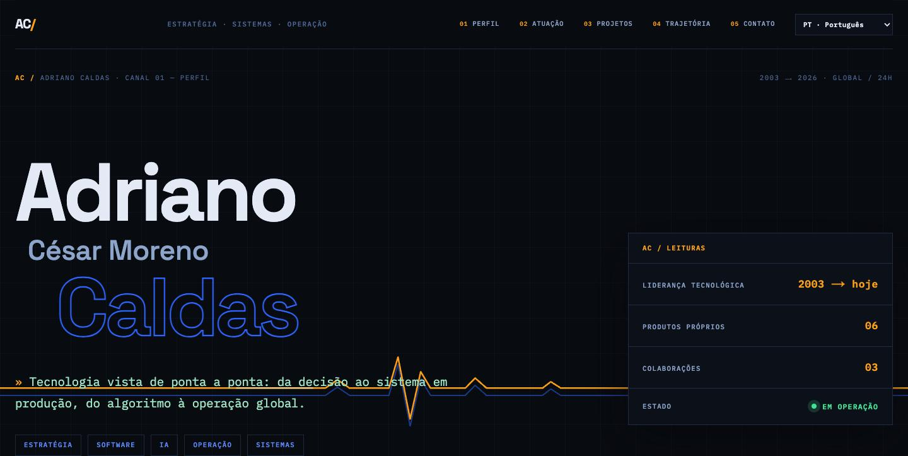
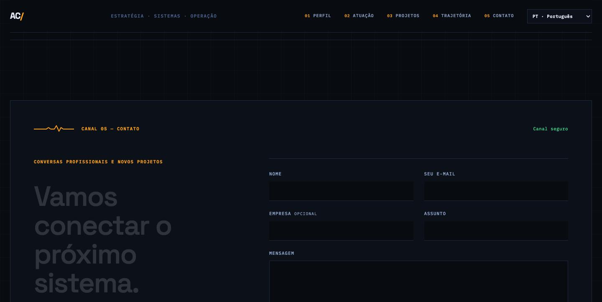

# adrianocaldas.com

Site pessoal de [Adriano César Moreno Caldas](https://adrianocaldas.com) — estratégia, sistemas e operação, desde 2003.



Identidade visual **«Sinal»**: uma sala de controlo escura onde uma linha de sinal âmbar — eco do início em processamento digital de sinais, em 2003 — atravessa o hero e liga os cinco canais da página (perfil, atuação, projetos, trajetória, contato).



## Características

- **Next.js 16** (App Router) com exportação estática — sem servidor, sem banco de dados, sem cookies, sem analytics;
- **4 idiomas** (pt · en · es · nb) com deteção pelo navegador e seleção manual via `?lang=`;
- **Contato protegido**: Cloudflare Turnstile + honeypot + Lambda de envio — nenhum e-mail pessoal publicado;
- **Acessibilidade**: contraste WCAG AA documentado no CSS, foco visível em todos os controlos, animações sob `prefers-reduced-motion`;
- **JSON-LD** (Person) e metadados hreflang para as quatro línguas;
- Testes de conteúdo que validam o HTML renderizado, a completude i18n e o contrato do formulário.

## Desenvolvimento local

Requer Node.js 22.13 ou superior.

```bash
npm install
npm run dev        # prévia em http://localhost:3000 (--port 3001 se ocupada)
```

Para o formulário funcionar localmente, copie `.env.example` para `.env.local` e defina a chave pública do widget em `NEXT_PUBLIC_TURNSTILE_SITE_KEY` (em localhost é usada automaticamente a chave de teste do Turnstile).

## Validação

```bash
npm test           # build + testes de conteúdo
npm run lint
npm audit --omit=dev
```

## Publicação

```bash
npm run build:s3   # gera out/ (exportação estática)
```

O conteúdo de `out/` é publicado como site estático (S3 + CloudFront) no domínio `adrianocaldas.com`.
